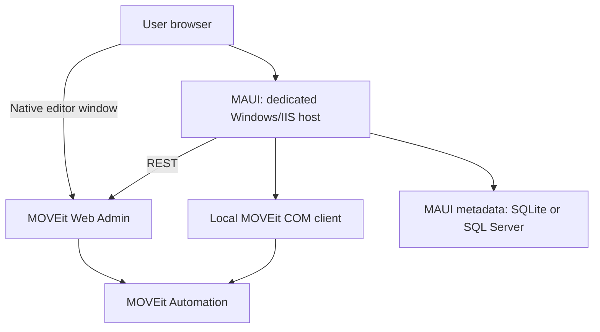

# MAUI - MOVEit Automation User Interface

- **Version:** `0.18.511-RC3`
- **Release:** Release Candidate 3 (RC3) — **not the final release**
- **Build:** `20261029`
- **Target framework:** .NET 8
- **Database schema / configuration version:** `1` / `1`

> **Pre-release software:** RC3 is a Release Candidate, not a final or general-availability release. It may contain bugs, regressions, incomplete features or behavior that differs on your MOVEit build. Use it for controlled evaluation and pre-production validation. Back up configuration and data, and test installation, upgrades and the workflows you intend to use before relying on this candidate in production. Passing automated tests does not establish that the software is bug-free or replace live MOVEit acceptance testing.

MAUI is a web administration interface for on-premises MOVEit Automation. MOVEit remains the system of record for Tasks, Hosts, Resources, execution history and Automation configuration. MAUI adds operational grids, metadata, reporting, administrative tools and optional MAUI editors around those capabilities.

## Project origin and independence

MAUI is an independently developed administration interface. **This project is not an AI reverse-engineered version of MOVEit Automation. No compiled MOVEit Automation code was disassembled or decompiled to build MAUI.** AI-assisted development was used to help implement this separate application; it does not constitute a reconstruction of MOVEit's compiled implementation.

MAUI integrates with MOVEit through REST APIs, the MOVEit Automation Windows COM API, and captured Web Admin request/response patterns. MOVEit Automation remains the system of record and execution engine. MAUI requires an existing, appropriately licensed MOVEit Automation installation; it does not replace that product or its license. The project is not affiliated with or supported by Progress Software.

## Documentation

- [`INSTALLATION.md`](INSTALLATION.md) - prerequisites, build, IIS deployment, database setup, Initial Setup, and MAUI Integration.
- [`UPGRADE.md`](UPGRADE.md) - application/configuration/database upgrade behavior and administrator upgrade procedure.
- [`TESTING.md`](TESTING.md) - automated regression suite, release gate, and manual smoke-test guidance.
- [`SECURITY.md`](SECURITY.md) - authentication/authorization, antiforgery, browser-rendering safeguards, dependency scanning, and static-analysis notes.
- [`CHANGELOG.md`](CHANGELOG.md) - release history, validation records and consolidated implementation notes.
- [`LICENSE`](LICENSE) - MAUI Community Source License 1.0.
- `Data/README.txt` - persistent Data-directory guidance.

**On this page:** [Editors](#optional-maui-editors) · [Permissions](#authentication-and-authorization) · [Copy To](#experimental-copy-between-environments) · [Hosting](#deployment-topology) · [Setup](#initial-setup) · [Upgrades](#upgrades).

## Compatibility and current support

> **Important — mixed MOVEit versions:** If MAUI connects to both MOVEit Automation 2025.x and 2026.x, install and register the **MOVEit Automation COM API 18.x**, or a later compatible version, on the MAUI server. Older COM API versions cannot connect to MOVEit Automation 2026.x. The newer COM API appears backward compatible with 2025.x at this time; validate connections and required workflows against each environment after upgrading. Restart the MAUI application pool after updating the COM API.

MAUI RC3 targets:

- MOVEit Automation **2025.x** and **2026.x**. Validate the exact MOVEit build and enabled capabilities in your environment before production use.
- MOVEit Automation installations with the **API capability licensed and enabled**.
- Windows/IIS hosting for MAUI.
- .NET 8 / ASP.NET Core.
- The MOVEit Automation Windows COM API installed and registered on the MAUI IIS server.
- SQLite or Microsoft SQL Server for the MAUI-owned metadata database.
- Desktop browser targets: **Google Chrome** and **Microsoft Edge**.
- Recommended display resolution: **1920x1080**.

MAUI is designed for on-premises MOVEit Automation. Compatibility with future MOVEit Automation releases must be validated before those versions are considered supported.

Version families and browser targets are not blanket certification of every build. Use the commit-specific validation record and the acceptance checks in [TESTING](TESTING.md) for the environment being deployed.

## RC3 scope and limitations

- MAUI uses MOVEit as its execution engine and requires a compatible, licensed installation. Retained COM operations and the native Web Admin integration remain required.
- AS1/AS2/AS3 Host/editor support remains deferred because the required license is unavailable. SSO is not supported.
- OneDrive Host configuration, Test Host and Browse Host are implemented for MOVEit 2026.0+ / native engine 18.0+; OneDrive Task-step editing and Quick Transfer composition await native Source/Destination patterns.
- Native Web Admin integration assets must be checked after MOVEit upgrades, which can replace Tomcat `index.html`.
- Automated tests validate application contracts and fixtures. They do not certify live authentication, protocol behavior, IIS deployment or every MOVEit build. Live S3/Google testing is unavailable; response parsing follows the supplied/accepted patterns.

See [current validation](TESTING.md#release-validation-evidence) and the [RC3 release overview](CHANGELOG.md#rc3-release-overview).

## Native functionality not included in RC3

The following MOVEit Automation functions are not included in MAUI RC3:

- **MOVEit System Log** - MAUI does not provide a replacement System Log view. The System Log remains available in the native MOVEit Web Admin interface when needed.
- **Service Shutdown** - A MAUI replacement was not considered necessary for this candidate. Service Shutdown remains available through the native MOVEit Web Admin interface.
- **Virus Test** - A MAUI replacement was not considered necessary for this candidate. Virus Test remains available through the native MOVEit Web Admin interface.
- **Watched Tasks** - Watched Tasks are not included in this candidate. MAUI support may be considered for a later release.

## Key capabilities

| Workspace | Main functions |
| --- | --- |
| Dashboard | Task/Host health, running Tasks, recent activity, certificate expiry and 24-hour transfer trends. |
| Tasks | Operational views, Calendar, execution controls, notifications, Preflight, folders, metadata, import/export and optional MAUI editors. |
| Hosts | Protocol inventories, configuration, connection tests, shared Browse, dependencies, metadata and supported import/export. |
| Resources | Scripts, Date Lists, Global Parameters, SSH/PGP keys, TLS certificates and optional Groups & Permissions administration. |
| Quick Transfer | MOVEit-admin-only one-off transfers using generated Traditional Tasks, optional PGP processing, Preflight and live status/cancellation. |
| Records and Reports | Task Run, File Activity and Audit grids; read-only Audit configuration comparisons on MOVEit 2026 or later; saved reports with scheduled/on-demand HTML and CSV email delivery. |
| Configuration | MOVEit connections, editor preferences, metadata, templates, SMTP, backups, scheduler, security and application logs. |

Shared grids provide filters, sorting, configurable columns, saved views, CSV/Print and per-user preferences. MAUI metadata includes Tags and organization-defined fields. Task/Host portability and spreadsheet imports use the shared object services; use the packaged templates under `Templates/TaskImport` and `Templates/HostImport`.

Release history, RC1/RC2 comparisons and detailed implementation contracts belong in [CHANGELOG.md](CHANGELOG.md).

## Optional MAUI editors

**Configuration > Settings > Editors** controls the preferred MAUI/native editor independently for Tasks, Hosts, Scripts, Date Lists, Groups & Permissions and MOVEit Settings. Save Configuration and reload MAUI after changing preferences. Fresh-install template defaults are **Tasks on; Hosts, Scripts, Date Lists, Groups & Permissions and MOVEit Settings off**. Existing installation choices are preserved. Groups & Permissions is restricted to MOVEit administrators.

The Task setting covers Traditional, Advanced and Synchronization together. Grid, Calendar and Information links use the same preferences; closing a related editor returns to the originating modal where supported. A disabled MAUI preference uses the normal native MOVEit integration, without an intermediate fallback page.

| Editor | Current supported workflows |
| --- | --- |
| Traditional Task | Source/Process/Destination steps (including Local File System), schedules, Next Actions, parameters, exceptions, timestamps and Run As Of. |
| Advanced Task | Ordered flow, File Loops, If/Else If/Otherwise branches, shared transfer/process panels, Send Email/Run Task, Update Original, comments, schedules and flow-image export. Text conditions offer Matches (`MASK`) and Not Matches (`NOTMASK`). |
| Synchronization Task | Folder configuration, direction/policy settings, schedules, listing/folder clear operations and Sync Preview. |
| Hosts | Captured properties for the mapped protocols, Local File System Host 0, credential preservation/replacement, SMTP/POP3 Custom/Microsoft 365 OAuth, SFTP algorithms/keys and supported Browse pickers. MOVEit 2026.0+ / engine 18.0+ adds OneDrive Host configuration and S3 IAM authentication; version-specific controls are hidden on older or unrecognized servers. |
| Scripts | Compact New form; Edit tabs for Script, Properties and assigned Tasks. PowerShell/VBScript Source, file import/templates, per-user Auto Save and guarded Undo/Export/Delete. Built-in Scripts honor the preference: the MAUI editor is read-only; administrators can maintain MAUI properties and metadata through Script Information. Disabling the preference opens native MOVEit. |
| Date Lists | New/Edit modal with entries and text import, Properties/Tasks, Auto Save, Undo/export/delete and shared checkout/revision handling. |
| MOVEit Settings | Logging and directory browse, Windows Event Log, task defaults/AS2 polling, state caching, tamper detection, IP/User policy and trusted IP addresses, plus active lockout lists with confirmed single/bulk unlocks, with revision/readback protection. |

Task and Host Auto Save are independent per-user preferences. **Undo Last Change** reverses one edit in the current opening; it is consumed after use and resets on reopen/reload. Grid saved-history Undo is a separate operation. Related editors honor preferences and return to their originating modal; messages stay in the active modal/footer.

**Checkout Objects for Duration of Edit** is under General > Application Behavior and defaults off. When enabled, editable Task/Host/Script/Date List editors retain checkout until Close/logout or abandonment cleanup. Conflicts show MOVEit's owner/time; only MOVEit administrators may explicitly override. Recovery retains the open form, pauses Auto Save and requires manual Save. Unsaved form values are not durable drafts. Read-only viewing acquires no edit checkout or Undo snapshot.

Task editors and Quick Transfer share the sortable Browse modal. Double-click a file to apply its folder and filename, or select a folder and click OK to preserve the filename. Host Actions > Browse Host is inspection-only. Traditional-to-Advanced conversion creates a unique disabled copy; Run As Of temporarily applies supported date-time macros and restores the original fields. See [editor acceptance](TESTING.md#rc3-editor-and-crud-acceptance) and [shared implementation](CHANGELOG.md#shared-crud-and-integration-reference) for the detailed contracts.

### Built-in Script guidance in Task editors

Process panels show live built-in Script descriptions, input/output parameters, required status, defaults and choices from MOVEit REST. Configure opens the appropriate Task/Process parameter form; a Global Parameter may supply a value. Viewing required placeholders does not save blank parameters. Built-in Script configuration stays read-only; permitted MAUI metadata changes use Script Information.

## MOVEit Settings (experimental)

Enable **Use MAUI Settings Editor** under Configuration > Settings > Editors, save configuration, then open **Configuration > MOVEit Settings**. The preference defaults off; both MAUI and MOVEit administrator access are required.

The editor covers Logging, Windows Event Log, Task defaults/AS2 polling, State File, Tamper Detection, IP/User Lockout Policy, trusted IP addresses and Lockouts. Unlocking addresses/users is a confirmed immediate action independent of the settings draft. Saves use short checkouts, revision checks and readback. See [acceptance guidance](TESTING.md#moveit-settings-editor-acceptance).

## Groups and Permissions

MOVEit administrators can enable **Use MAUI Group & Permissions Editor** under Configuration > Settings > Editors. Parent Resource Group rows summarize All / Some / None; expanded rows show exact User Group grants.

The shared grid supports Resource Group creation/membership, Local/Domain User Group assignments, inline permissions and guarded deletion. New assignments start with grants off; Task Add/Edit/Delete requires Edit Existing. Deleting a Resource Group does not delete its member objects. See [permission acceptance](TESTING.md#groups-and-permissions-acceptance).

## Shared MOVEit Task CRUD architecture

Tasks and Hosts each use one authoritative CRUD coordinator. Traditional Task writes use REST v1; Advanced/Sync and supported Host configuration writes use captured REST v0. Imports, Quick Transfer and editors reuse the appropriate shared services. Retained native configuration operations continue to use COM.

Saves validate current identity, permission and revision under checkout, preserve unowned fields/credentials, write once and verify readback. Unconfirmed mutations are not automatically replayed. See [transport ownership and recovery](CHANGELOG.md#shared-crud-and-integration-reference).

## Shared Resources CRUD architecture

Scripts and Date Lists have shared CRUD coordinators and checkout/revision handling. Global Parameter Information is its edit surface; Keys & Certificates use creation and Information forms rather than separate editors.

PowerShell templates are environment-scoped and managed under General > Script Templates. Saving shared Script/email templates from editable modals requires either MOVEit administrator or MAUI administrator status; Configuration management retains its MAUI Admin requirement. Importing/applying Script source does not execute it. See [resource implementation](CHANGELOG.md#resources-script-guidance-and-modal-feedback).

## Experimental Task JSON Editor

Enable **Task JSON Editor** under Configuration > Settings > Experimental, save configuration and reload Tasks. Select Tasks and choose **Bulk Actions > JSON Editor**. Edit individual JSON values or find matching elements across Tasks, preview replacements and review changes before Save. Apply actions remain local; existing Task edit permissions and checkout rules apply. Native identities/references, credentials and other managed values are read-only. See the [acceptance checks and limits](TESTING.md#task-json-editor-acceptance).

## Experimental Copy Between Environments

**Copy To** is off by default under Configuration > Settings > Experimental. It requires both MOVEit administrator status and MAUI Admin access, at least two distinct configured environments, and working administrator Data Access credentials for both. HA nodes sharing an Environment Key count as one environment.

Use a supported row menu or Bulk Actions in Tasks, Hosts, Scripts, Date Lists or Keys & Certificates. Objects, Resolve, Review and Results guide dependency selection, conflict resolution, naming, Resource Group/Task-folder placement and compatible MAUI metadata. Source is the current connection. All conflicts must be resolved before Review; overwrite requires explicit confirmation. New/overwritten Tasks remain disabled.

- Built-in Scripts and Local File System Host 0 are reused, not copied. Keys are matched by identity; this feature does not rename or overwrite them.
- Standalone SSH/private-PGP transfer, AS1/AS2/AS3, Global Parameters and references embedded in free-form text are outside automatic copying. Task/Host native dependency export can carry supported key material. Resource Group permission assignments are not copied; Date List group placement is not supported by MOVEit's group member types.
- Compatible metadata copies without changing destination definitions. Metadata-only differences remain **Completed** with blue rows; actual warnings are yellow and failures/unverified writes red.
- Execution continues after modal Close, stops before the next write when requested, and never automatically replays an uncertain write. Restart marks unfinished work Interrupted. Retained reports/recovery files default to 30 days (configurable 1–90); preserve `Data/EnvironmentCopy` and Data Protection keys.

See [Copy To contracts and limitations](CHANGELOG.md#copy-between-environments) and [two-environment acceptance](TESTING.md#copy-between-environments-acceptance).

## Grid Date/Time filters

The Tasks searchbox also searches stored Source masks and Destination filenames on demand. Matching is case-insensitive and literal (`*.txt` searches for that configured mask); normal grid loads do not fetch steps. Refresh Now refreshes an active filename search. See [filename search acceptance](TESTING.md#task-filename-search-acceptance).

Date/Time columns support `<`, `<=`, `>`, `>=`, `!`/`not:` and comma or `or` alternatives. Enter a numeric date (`10/21/2026`), named-month date (`Oct 21, 2026`) or ISO date (`2026-10-21`), with a 12-hour or 24-hour time when needed. Date-only comparisons use whole-day boundaries; timestamps compare the supplied time. Partial text filtering remains available. Commas inside named-month dates are not OR separators.

The clock picker and Filter Help include `[nextmonth]`, `[nextquarter]` and `[nextyear]`. These are the next complete calendar periods, based on the MAUI application's local date, rather than rolling 30/90/365-day windows. For example, `<=[nextmonth]` matches through the end of next month, and `<[today], [nextmonth]` matches dates before today or anywhere in next month. Saved Views and scheduled Reports retain these expressions and resolve them when evaluated. Explicit-offset timestamps are interpreted in the application's local time zone.

## MOVEit connection feedback

MOVEit-backed grid loads and refreshes show a shared **MOVEit Unreachable** banner when MAUI detects a DNS, refused-connection or network failure, or after two consecutive timed-out grid requests. This describes connectivity from the MAUI server; it does not prove that the Windows server is shut down. Existing rows remain visible after a failed refresh and may be stale. Repeated connection-error toasts are suppressed while the banner is active.

Toast messages stay inside the active modal while it is open; page updates are labelled separately from editor errors. Signed-in toast errors, warnings and information are sent to Configuration > Logs. Logging is best effort and does not block the operation if MAUI or its logging database is unavailable.

Refresh intervals, Pause/Resume and Refresh Now keep their existing behavior. The banner clears after a successful live grid read; cached data alone cannot establish recovery. State follows the current tab, login, connection and IIS application. Authentication/permission errors, ordinary HTTP 500, certificate errors and malformed data remain separate. Local-only grids do not probe MOVEit, and this feature does not retry editor saves, creates, deletes or checkout operations. See [connection acceptance](TESTING.md#moveit-connection-banner-acceptance).

## MOVEit license-aware behavior

MAUI reads MOVEit license information at sign-in and enforces supported capabilities on the server and in the UI. Advanced Task creation, custom Script management, PGP operations and finite Task/Host capacity follow those rights; creating/importing/cloning/restoring cannot bypass them. Existing-object behavior remains subject to its normal permissions. AS2 and Backup Host attributes are informational in RC3.

See [licensing coverage](TESTING.md#licensing-and-capacity).

## Authentication and authorization

Users authenticate with their MOVEit Automation username and password. MOVEit access and refresh tokens remain server-side and are not stored in browser cookies or application HTML. Normal protected requests require the corresponding live server-side MOVEit session; if that session expires or is lost during an application recycle, the user must sign in again.

MAUI maintains its own Admin/User authorization in the metadata database:

- The first successfully authenticated user in a new MAUI database becomes a MAUI Admin.
- Later previously unseen MOVEit users are registered as MAUI Users.
- MAUI Admins manage roles under **Configuration > Settings > Security**.
- MOVEit administrator status does not automatically grant the MAUI Admin role.

Saving shared Script or email templates is a specific exception: a live session with either administrator role can save from the relevant editable modal. This does not grant access to MAUI administration pages or additional MOVEit object rights.

The MOVEit password is retained only in server memory for the active session when required for native-editor and COM operations. It is not persisted in `appsettings.json`.

### MOVEit object permissions

MOVEit permissions remain separate from the MAUI Admin/User role. MAUI checks the signed-in MOVEit user's effective rights for each visible object and enforces writes on the server as well as in the UI. Task **Edit Existing** permits editing the complete existing Task, including adding/removing steps; it does not grant object creation or deletion.

- New/import availability uses the user's eligible Resource Groups across grants. Non-admin creation of Tasks, Hosts, Scripts, TLS certificates, SSH keys and PGP keys requires an eligible Resource Group as the first field above Name. The selector is hidden for MOVEit administrators. Task/Host Auto Format Name remains immediately below Name. Date List creation remains administrator-only.
- Edit, notifications, metadata updates and configuration exports require edit access; deletion and running Tasks require their respective rights. Bulk selection and Bulk Actions are unavailable when the grid offers no permitted action for that row/selection. Run-only access does not enable selection in a Task grid without a Run bulk action.
- Visible objects can open through the configured editor in read-only mode. Read-only editors lock MOVEit configuration and MAUI properties/metadata, hide mutation controls, show their status in the footer and close without a discard prompt. Read-only viewing does not prepare edit/Undo snapshots or acquire an editing checkout.
- Information modals hide **Save** when the current user cannot edit that object, including after switching tabs. Opening an editable object restores its normal Save/readiness behavior.
- Global Parameters remain visible and usable to all users. Only MOVEit administrators can open their Information modal or delete them. Resource Group creation, membership and permission administration are also restricted to MOVEit administrators.
- Task folders remain visible/filterable to non-admins; only MOVEit administrators can manage folders or change a Task's folder assignment.

## Application workspaces

The [workspace summary](#key-capabilities) covers day-to-day navigation. Quick Transfer is enabled under General and uses one available Traditional Task slot. Successful temporary `ADHOC_*` Tasks are eligible for verified background cleanup; failed/cancelled/no-transfer or ambiguous runs are retained. Live monitor tokens do not survive process restart. Unattended cleanup requires Data Access credentials. See [Quick Transfer acceptance](TESTING.md#quick-transfer-validation).

Reports preserve grid state and use configured SMTP for delivery; source authorization is checked when definitions change and when reports run. Task views distinguish schedule state from the configured schedule, and Preflight does not run a Task.

### Configuration

| Settings location | Purpose |
| --- | --- |
| General > Application Behavior | Naming defaults, optional edit-duration checkout and Task Failure Alerts. |
| General > Folders | Create root Task folders from Resource Group names; MOVEit-admin-only immediate action. |
| General > Script/Notification Templates | Environment-scoped shared templates. Load Script Templates from .txt/.ps1 files or Notification Templates from text/HTML files and edit their names, subjects and message bodies directly in Settings. |
| Editors | All six MAUI/native editor preferences. |
| MOVEit Connections | Environment definitions and unattended Data Access credentials. |
| SSH/KEX Algorithms | Live supported choices and configured ordered defaults for new SFTP Hosts/Reset. |
| Backup | Manual/automatic backups, retention and per-environment MOVEit restore selection. |
| Advanced | Keep Alive, controlled restart and Factory Reset. |
| Experimental | Opt-in Task JSON Editor and Copy Between Environments. |

Connection-list updates apply to new logins/background connections without restarting. Existing sessions retain their original endpoint; changing an endpoint/COM host/Environment Key clears unattended credentials. Startup-sensitive runtime/database settings still require restart. See [post-install configuration](INSTALLATION.md#9-after-setup---first-steps).

## Deployment topology

MAUI should run on a **dedicated Windows IIS server or virtual machine** separate from the MOVEit Automation server.

**Do not install MAUI on the MOVEit Automation server.** Keep the Automation server dedicated to MOVEit Automation and deploy MAUI to a separate IIS host with network access to MOVEit Web Admin and the selected metadata database.

**RC3 supports one active MAUI application instance/worker.** If IIS is used, configure the MAUI application pool with **Maximum Worker Processes = 1**. SQL Server is a supported metadata provider but does not make the MAUI web tier multi-node/active-active capable.

A typical deployment is:

See [`INSTALLATION.md`](INSTALLATION.md) for detailed prerequisites, build, IIS, database, Initial Setup, and MAUI Integration instructions.

## Integration architecture

REST provides authentication, inventories, status/reports and supported object operations. The locally registered Windows COM API supplies retained native configuration operations. The Web Admin integration launches native editing according to preferences. SQLite or SQL Server stores MAUI-only state; MOVEit remains authoritative for Automation configuration and execution.

See [shared object boundaries](CHANGELOG.md#shared-object-boundaries-and-transport-ownership).

## Metadata database choices

SQLite defaults to `Data\maui.db`; SQL Server supports Windows or SQL authentication. Both use the same supported single-instance MAUI topology. Keep database files outside `wwwroot`, protect `Data`, and arrange separate SQL Server database backups. Persistent SQLite `file:` URI sources are rejected.

See [database prerequisites](INSTALLATION.md#3-choose-the-maui-metadata-database).

## Native MOVEit Web Admin integration

Install the three supplied assets from `IntegrationAssets/MOVEitWebAdmin` on every applicable Web Admin/Tomcat node and add the script reference to `index.html`. Configure `LAUNCHER_ORIGINS` with each exact trusted MAUI browser origin before deployment. Recheck this integration after vendor upgrades.

Follow the [complete integration procedure](INSTALLATION.md#7-configure-maui-integration-on-moveit-web-admin), including localhost and HA-node guidance.

## Build and source

Open `MoveItAutomationUI.sln` with Visual Studio 2022 or later and the ASP.NET/web workload, or use the .NET 8 SDK. The application can run locally with the included HTTPS launch profile; the workstation still needs the compatible COM API.

Use the [build/deployment instructions](INSTALLATION.md#4-build-maui) and [release validation gate](TESTING.md#rc3-release-validation-gate). Windows build/publish verifies that the DLL, release template and upgrade manifest agree.

## Release-controlled vs installation-owned files

Deploy one complete matching publish output. Preserve the installed **`appsettings.json` and entire `Data` directory**, including databases, backups, cleanup/recovery records and Data Protection keys. Build and publish exclude appsettings.json. For a new installation only, an administrator must create that file containing `{}` before MAUI starts; preserve any existing file.

Release templates, `appsettings.custom.json`, `upgrade.json` and application assets must be updated with the binaries. Do not use a broad `appsettings*.json` deployment exclusion or delete the destination directory. See [deployment protection](UPGRADE.md#protect-installation-owned-content).

## Initial Setup

Deploy to a dedicated Windows/IIS host, create appsettings.json containing `{}` only if it does not exist, grant Read on application files and Modify only on that existing file and Data, then open MAUI. Setup tests Web Admin reachability, local COM activation and the metadata database, provisions schema/configuration version 1 and proceeds to Login without an IIS restart. The first authenticated user becomes a MAUI Admin.

Follow [Initial Setup](INSTALLATION.md#8-run-initial-setup), then configure Data Access credentials, backups, SMTP and System Jobs as needed. Scheduled jobs require IIS startup/preload; [Keep Alive](INSTALLATION.md#keep-maui-running-for-scheduled-jobs) cannot start a stopped application.

## Upgrades

Back up configuration/data, close editors and finish active transfers/copies, then take MAUI offline and deploy a complete matching publish. Preserve installation-owned files and verify the destination package before restarting. Complete `/Upgrade` as a MAUI Admin if requested and validate the required workflows.

The current manifest does not force an additional restart. Startup-sensitive changes can require **Restart MAUI**; other completed upgrades offer **Return to MAUI**. See [UPGRADE.md](UPGRADE.md) for the full procedure, recovery and restart rules.

## Security

MAUI uses authenticated server-side MOVEit sessions, database-backed MAUI roles, ASP.NET Core antiforgery validation, server-side token storage, explicit native-editor origin/source checks, and sanitized handling of user-authored notification HTML.

See [`SECURITY.md`](SECURITY.md) for the supported security-policy scope, private vulnerability-reporting guidance, implementation notes, dependency/static-analysis guidance, and documented scanner false positives. See [`TESTING.md`](TESTING.md) for the RC3 security/release validation gate.

## License and source availability

Copyright (C) 2026 Marc R. Davis.

MAUI is **source-available** software distributed under the **MAUI Community Source License 1.0**, included in [`LICENSE`](LICENSE). The license permits internal organizational use, study, modification, noncommercial redistribution, and professional implementation/support services subject to its terms. Distributed derivative works must remain source-available under the same license. MAUI or a derivative may not be sold, commercially licensed as software, or offered as a paid hosted software service without separate written permission from the copyright holder.

Because the license restricts certain commercial software uses, MAUI should not be described as OSI-approved open-source software. Review the complete `LICENSE` terms before use or redistribution.

## Disclaimer and trademarks

MAUI is an independent project. It is **not affiliated with, endorsed by, sponsored by, or supported by Progress Software Corporation**. Progress Software provides no support or warranty for MAUI.

This software is provided **"as is"**, without warranty of any kind, express or implied, including but not limited to warranties of merchantability, fitness for a particular purpose, and noninfringement. Use of MAUI is at your own risk. The author(s) and contributors are not liable for claims, damages, data loss, service interruption, or other liability arising from use of the software to the extent permitted by applicable law.

Administrators are responsible for validating MAUI in their own environment, maintaining appropriate backups, protecting credentials/configuration, complying with applicable MOVEit licensing, and following their organization's security/change-management requirements.

Progress, MOVEit, and related Progress product names and marks are trademarks or registered trademarks of **Progress Software Corporation and/or its subsidiaries or affiliates** in the United States and other countries. Their use in this project is referential only and does not imply affiliation, endorsement, or sponsorship. See the [Progress Software Corporation trademark policy](https://www.progress.com/legal/trademarks/trademarks-use-policy) for current trademark guidance.

## Documentation maintenance

Maintain only `README.md`, `CHANGELOG.md`, `INSTALLATION.md`, `SECURITY.md`, `TESTING.md`, `UPGRADE.md` and the existing `LICENSE`. Incorporate implementation and validation notes into these documents. **Do not create a new `.md` file without Marc's approval.** Keep current RC3 guidance separate from historical release notes and distinguish automated checks from live IIS/MOVEit acceptance.
